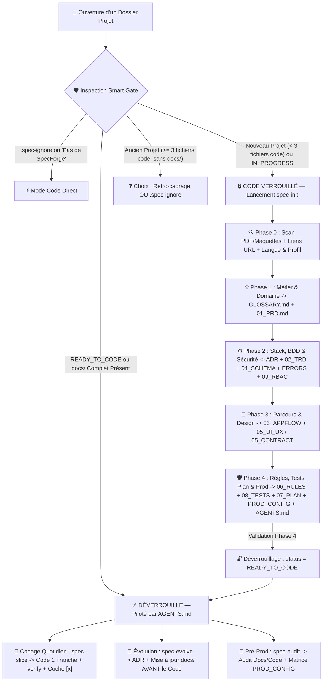

<div align="center">
  
  <h1>SpecForge — Développement Piloté par Spécifications pour IA</h1>
  <p><strong>Zéro Hallucination. Zéro Code Spaghetti. Zéro Ligne de Code avant les Spécifications Validées.</strong></p>
  <p>
    <a href="./README.md">🇬🇧 English</a> &nbsp;|&nbsp;
    <strong>🇫🇷 Français</strong> &nbsp;|&nbsp;
    <a href="./README.tr.md">🇹🇷 Türkçe</a>
  </p>
</div>

---

## 📖 Sommaire

1. [Philosophie — Pourquoi SpecForge ?](#-1-philosophie--pourquoi-specforge-)
2. [Fonctionnement Global (Schéma d'Architecture)](#-2-fonctionnement-global-schéma-darchitecture)
3. [Installation Globale & Désinstallation](#-3-installation-globale--désinstallation)
4. [Guide Complet de A à Z : Partir de Zéro jusqu'à la Production](#-4-guide-complet-de-a-à-z--partir-de-zéro-jusquà-la-production)
5. [Référentiel Détaillé des 14 Documents Générés & du Pack Multi-Équipe](#-5-référentiel-détaillé-des-14-documents-générés--du-pack-multi-équipe)
6. [Matrice Universelle d'Adaptation (Plateformes & Langages)](#-6-matrice-universelle-dadaptation-plateformes--langages)
7. [Verrou Smart Gate, Petits Projets (.spec-ignore), Pause/Reprise & FAQ](#-7-verrou-smart-gate-petits-projets-spec-ignore-pausereprise--faq)
8. [Licence](#-8-licence)

---

## 🎯 1. Philosophie — Pourquoi SpecForge ?

Un agent IA n'a ni mémoire architecturale à long terme, ni intuition métier. Lorsqu'on ouvre un dossier vide et qu'on lui demande *« Crée-moi une application de livraison / réservation / SaaS »* sans cadre préalable :
- **Il improvise des routes et schémas incompatibles** entre le frontend et le backend.
- **Il mélange le vocabulaire métier** (appelant la même entité tantôt `Colis`, tantôt `Package`, tantôt `Shipment`).
- **Il souffre d'amnésie architecturale** (trois jours plus tard, une nouvelle session propose de changer de librairie ou viole une règle financière fixée au Jour 1).
- **Il génère des fichiers monstres** (composants de 900 lignes mélangeant interface, appels réseau et calculs financiers côté client).

**SpecForge élimine ces dérives grâce au *Spec-Driven AI Development* :**
> **L'IA a l'interdiction formelle et technique d'écrire la moindre ligne de code applicatif tant que le projet n'a pas été intégralement pensé, spécifié et validé dans `docs/` + `AGENTS.md`.**

Une fois déverrouillé, `docs/` devient la **Source Unique de Vérité**, et l'IA exécute le développement tranche par tranche avec la rigueur d'un Architecte Senior.

---

## 🔄 2. Fonctionnement Global (Schéma d'Architecture)



---

## 📦 3. Installation Globale & Désinstallation

SpecForge s'installe globalement et fonctionne sur **Google Antigravity** (Plugin natif complet + Hook `PreToolUse` + Règle Globale), **Cursor**, **Claude Code**, **Windsurf** et **GitHub Copilot**.

### ✨ Option 1 — Installation Automatique par Prompt IA (Zéro Terminal !)

Vous ne voulez taper aucune commande ? **Copiez-collez simplement ce prompt dans votre assistant IA** : il fera toute l'installation et vous expliquera le fonctionnement !

```text
Installe globalement le plugin et les skills SpecForge depuis https://github.com/Ismael-sang98/spec-forge-skill.git sur ma machine :
1. Clone https://github.com/Ismael-sang98/spec-forge-skill.git dans un dossier temporaire.
2. Détecte mon système d'exploitation et exécute "./install.sh" (macOS/Linux) ou "powershell -ExecutionPolicy Bypass -File .\install.ps1" (Windows) afin d'installer globalement le plugin complet, le verrou Smart Gate et les 4 skills (spec-init, spec-slice, spec-evolve, spec-audit).
3. Vérifie que les fichiers sont bien installés, supprime le dossier temporaire cloné, puis explique-moi clairement en français comment fonctionne SpecForge, comment agit le verrou "Zéro Code avant les Docs", quand utiliser chacun des 4 skills, et rappelle-moi de redémarrer mon IDE une fois.
```

---

### 🛠️ Option 2 — Installation Manuelle en Terminal (Plugin Complet + Hook Smart Gate)

**macOS & Linux :**
```bash
git clone https://github.com/Ismael-sang98/spec-forge-skill.git
cd spec-forge-skill
chmod +x install.sh && ./install.sh
```

**Windows (PowerShell) :**
```powershell
git clone https://github.com/Ismael-sang98/spec-forge-skill.git
cd spec-forge-skill
powershell -ExecutionPolicy Bypass -File .\install.ps1
```

**Ou directement via le CLI Antigravity :**
```bash
agy plugin install ./spec-forge-skill
```

> **🔄 Important :** Redémarrez votre IDE IA **une seule fois** après l'installation pour charger le nouveau plugin global, le hook `PreToolUse`, la règle globale et les 4 skills.

---

### 🌐 Option 3 — Via `npx skills` (Mode Skills Universels)

```bash
npx skills add Ismael-sang98/spec-forge-skill -g
```

---

### 🗑️ Désinstallation

- **macOS / Linux** : `./install.sh --uninstall` (ou `agy plugin uninstall spec-forge`)
- **Windows PowerShell** : `powershell -ExecutionPolicy Bypass -File .\install.ps1 -Uninstall`

---

## 🚀 4. Guide Complet de A à Z : Partir de Zéro jusqu'à la Production

Voici **tous les détails exacts des procédures** dès que vous démarrez un projet avec SpecForge.

### Étape 0 — Préparer le Dossier du Projet (Pièces Jointes & Liens Optionnels)
1. Créez un dossier vide pour votre nouveau projet (ex: `mkdir CampusFoot`) et ouvrez-le dans votre IDE.
2. *(Optionnel)* Si vous avez déjà de la matière, glissez-la directement dans ce dossier avant de commencer :
   - Cahier des charges client en `.pdf`, énoncé de projet universitaire, notes `.md` / `.txt` ou grille tarifaire `.csv`.
   - Captures d'écrans Figma, wireframes ou photos de croquis sur papier dans `docs/maquettes/`.
   - Fichier d'API existant (`openapi.yaml`, `swagger.json`).

---

### Étape 1 — Déclencher SpecForge (Blocage Automatique vs Lancement Direct)

- **Que se passe-t-il si vous oubliez la méthode et demandez de coder tout de suite ?**  
  *(ex: « Crée-moi l'application en Flutter avec une page de connexion »)*  
  🛑 **Le Verrou *Smart Gate* (`scripts/spec-gate.mjs`) bloque physiquement l'écriture du code (`decision: "deny"`)** ! Comme le dossier contient moins de 3 fichiers de code et aucun `docs/` validé, l'IA s'arrête net et lance **`spec-init`** à la place.
- **Comment démarrer proprement (Prompt type recommandé) :**
  ```text
  Utilise spec-init : je veux créer CampusFoot, une application mobile où des étudiants réservent des terrains de sport et partagent le paiement entre joueurs. Voici un site dont j'aime le principe : https://anybuddyapp.com
  ```

---

### Étape 2 — Comment `spec-init` Comprend Votre Idée, vos Docs, vos Liens & Votre Stack

`spec-init` fonctionne comme un **CTO Co-Pilote** qui ne vous laisse jamais devant une page blanche :

1. **Ingestion Multimodale Automatique** :
   - Ouvre et lit tous vos PDF, notes et captures de maquettes (`docs/maquettes/`) déposés dans le dossier.
   - Explore tous les **liens URL externes** que vous lui donnez (sites concurrents, documentation officielle Stripe / Iyzico / Supabase / WhatsApp API, dépôts GitHub) pour ne jamais inventer des endpoints obsolètes.
   - **Détecteur Proactif de Sources Manquantes** : Dès que vous évoquez des règles complexes (barème douanier, TVA, commissions, scores) ou une API tierce, l'IA vous demande si vous avez un tableau/PDF ou le lien de la doc avant d'écrire la moindre formule.
2. **Multilingue Intelligent** :
   - Mène automatiquement l'interview dans **votre langue active** (Français, Turc, Anglais, etc.).
   - Vous fait confirmer en 1 clic la langue de rédaction de `docs/`, tout en imposant des **identifiants techniques en anglais propre** dans le code et la BDD via `docs/GLOSSARY.md`.
3. **2 Profils de Rigueur au Choix** :
   - **`(Recommended)` Architecture Complète Entreprise (14 Docs)** : Cadrage intégral pour SaaS, projets clients, apps mobiles/desktop ou APIs de production.
   - **Profil Lean / MVP / Projet Universitaire (8 Docs Essentiels)** : Version allégée idéale pour les TPs, hackathons ou petits outils (fusionne proprement Glossaire+PRD, Erreurs+RBAC dans le TRD, et Tests+Coding Rules).
4. **3 Profils de Choix de Stack Gérés Automatiquement** :
   - **Cas A — Vous connaissez déjà votre stack** *(ex: « React + Express + Prisma + Supabase »)* : Valide sa cohérence, tranche les angles morts (mode offline, cookies/JWT, transactions) et la grave dans `ADR-0001`.
   - **Cas B — Vous hésitez sur la stack / l'architecture** : Agit en CTO — évalue vos contraintes (niveau de l'équipe, budget 0 € gratuit vs cloud, deadline, OS) et compare 2 à 3 stacks complètes avec **1 choix `(Recommended)`**.
   - **Cas C — Contrainte imposée** *(ex: cours universitaire imposant Java Spring Boot ou C# .NET)* : Respecte la contrainte à 100 % et conçoit la meilleure architecture autour.

---

### Étape 3 — Le Déroulement Détaillé des 4 Phases Interactives

À chaque question, l'IA place une réponse **`(Recommended)`** en premier choix (validation en 1 clic ou personnalisation). L'avancement est sauvegardé à chaque étape dans `docs/.spec-state.json`, et **aucun placeholder `[TODO]` n'est toléré** :

| Phase | Questions Posées par l'IA | Fichiers Générés Immédiatement (100 % Complets, Zéro `[TODO]`) |
| :--- | :--- | :--- |
| **Phase 0**<br>*Découverte & Profil* | Idée brute, plateforme cible (`Web`, `Mobile`, `Desktop`, `Backend/API`, `CLI`), contraintes, liens/fichiers joints, langue de `docs/` et profil Complet (14) vs Lean (8). | • `docs/.spec-state.json` (`status: "IN_PROGRESS"`, `currentPhase: 1`) |
| **Phase 1**<br>*Métier & Domaine* | Personas, modules inclus vs hors-périmètre, formules exactes de prix/devises/arrondis/remboursements, cas limites et termes métier ambigus. | • `docs/GLOSSARY.md`<br>• `docs/01_PRD.md` |
| **Phase 2**<br>*Stack, BDD & Sécurité* | Choix stack & pattern d'architecture, tables & relations, cascades/index, rôles utilisateurs & permissions CRUD, services tiers & webhooks. | • `docs/adr/0001-stack-and-architecture.md`<br>• `docs/02_TRD_TECHNICAL_SPEC.md`<br>• `docs/04_DATABASE_SCHEMA.md`<br>• `docs/ERROR_CATALOG.md`<br>• `docs/09_RBAC_PERMISSIONS.md` |
| **Phase 3**<br>*Parcours & Design / API* | Arborescence des écrans/commandes, Machines à États Finis (transitions autorisées et interdites), extraction visuelle de `docs/maquettes/` (ou création d'un Design System complet ; ou contrat OpenAPI/CLI si sans interface). | • `docs/03_APPFLOW.md`<br>• `docs/05_UI_UX_DESIGN.md` *(ou `05_INTERFACE_CONTRACT.md` pour API/CLI sans UI)* |
| **Phase 4**<br>*Qualité, Plan & Déverrouillage* | Standards de code adaptés à la stack, pyramide de tests, découpage chronologique en tranches verticales, hébergement et sécurité pré-production. | • `docs/06_CODING_RULES.md`<br>• `docs/08_TESTING_STRATEGY.md`<br>• `docs/07_IMPLEMENTATION_PLAN.md`<br>• `docs/PROD_CONFIG.md` & `docs/README.md`<br>• **Pack Racine :** `AGENTS.md`, `.cursorrules`, `CLAUDE.md`, `.env.example`, commande `verify`<br>• **Déverrouillage :** `docs/.spec-state.json` $\rightarrow$ `"READY_TO_CODE"` 🔓 |

---

### Étape 4 — Coder, Faire Évoluer et Auditer le Projet (Prompts du Quotidien)

Dès que la Phase 4 est validée (`READY_TO_CODE`), vous pilotez toute la réalisation avec **3 commandes simples** :

#### 1. Coder Fonctionnalité par Fonctionnalité (`spec-slice`)
```text
Lance spec-slice pour implémenter la prochaine tranche non cochée de docs/07_IMPLEMENTATION_PLAN.md
```
**Ce que fait l'IA automatiquement :**
1. Relit les sections exactes de `AGENTS.md`, `GLOSSARY.md`, `01_PRD`, `02_TRD`, `03_APPFLOW`, `04_DATABASE_SCHEMA`, `05_UI_UX` et `06_CODING_RULES`.
2. Code la tranche verticalement de bout en bout : **Validation/DTOs $\rightarrow$ Modèle BDD & Migration $\rightarrow$ Service Métier & Transactions ACID $\rightarrow$ Tests Unitaires/Intégration $\rightarrow$ Contrôleur/API $\rightarrow$ Interface UI ($\le 200$ lignes)**.
3. Exécute la commande globale **`verify`** (`typecheck + lint + test + build`) jusqu'à obtenir 0 erreur.
4. Coche `[x]` dans `docs/07_IMPLEMENTATION_PLAN.md` et restitue le rapport obligatoire (**Ce qui a été fait / Ce qui reste à faire / % Global**).

#### 2. Ajouter une Idée ou Changer une Règle en Cours de Projet (`spec-evolve`)
```text
Utilise spec-evolve : je veux ajouter un système de tournois le week-end et le paiement Apple Pay
```
**Ce que fait l'IA automatiquement :**
1. Analyse tous les documents impactés au lieu de bricoler le code à l'aveugle.
2. Pose les questions d'arbitrage, crée un nouvel ADR numéroté (`docs/adr/0002-tournois-weekend.md`), met à jour `docs/` + `.env.example`, et ajoute une nouvelle tranche `[ ]` dans `docs/07_IMPLEMENTATION_PLAN.md` **avant** de toucher au code.

#### 3. Vérifier la Qualité et Préparer la Production (`spec-audit`)
```text
Lance spec-audit pour vérifier la conformité entre docs/ et le code ainsi que docs/PROD_CONFIG.md
```
**Ce que fait l'IA automatiquement :**
1. Scanne le code réel à la recherche de fuites `any`/`dynamic`, fichiers `> 200` lignes, écarts au glossaire, oublis de middlewares RBAC, écritures hors transaction ACID, ou jetons/mocks de démo oubliés.
2. Exécute `verify`, audite 100 % des 6 piliers de `docs/PROD_CONFIG.md`, et délivre un **Score de Maturité `/100`** classé par gravité (`P0` à `P3`).

---

## 📚 5. Référentiel Détaillé des 14 Documents Générés & du Pack Multi-Équipe

```text
MonProjet/
├── AGENTS.md                          # Constitution suprême & 12 Commandements adaptés à la stack
├── .cursorrules                       # Miroir automatique pour les coéquipiers sur Cursor
├── CLAUDE.md                          # Miroir automatique pour les coéquipiers sur Claude Code
├── .env.example                       # Matrice documentée des variables d'environnement (zéro secret réel)
└── docs/
    ├── .spec-state.json               # Sauvegarde d'avancement des phases & statut READY_TO_CODE
    ├── README.md                      # Index centralisateur reliant toutes les spécifications
    ├── GLOSSARY.md                    # Glossaire métier (Terme local <-> Identifiant Code/BDD Anglais)
    ├── ERROR_CATALOG.md               # Enveloppe d'erreur standard & catalogue des codes d'erreurs
    ├── 01_PRD.md                      # Vision métier, personas, invariants & formules chiffrées
    ├── 02_TRD_TECHNICAL_SPEC.md       # Architecture, stack, contrats d'API complets & transactions ACID
    ├── 03_APPFLOW.md                  # Routes/commandes, diagrammes de séquence & machines à états
    ├── 04_DATABASE_SCHEMA.md          # ERD Mermaid, schéma ORM/SQL complet, cascades, index & seeds
    ├── 05_UI_UX_DESIGN.md             # Design tokens & mapping écrans (ou 05_INTERFACE_CONTRACT.md)
    ├── 06_CODING_RULES.md             # Clean architecture, limite <= 200 lignes & anti-patterns bannis
    ├── 07_IMPLEMENTATION_PLAN.md      # Feuille de route en tranches verticales à cocher [ ] / [x]
    ├── 08_TESTING_STRATEGY.md         # Pyramide de tests, factories réutilisables & couverture exigée
    ├── 09_RBAC_PERMISSIONS.md         # Matrice Rôle x Ressource CRUD & isolation multi-locataire
    ├── PROD_CONFIG.md                 # Matrice d'audit sécurité et durcissement pré-production (6 piliers)
    ├── adr/                           # Registre immuable des décisions d'architecture (ADR)
    │   └── 0001-stack-and-architecture.md
    └── maquettes/                     # Exports Figma / wireframes / captures d'écran
```

| Fichier | Rôle Exact | Problème Éliminé |
| :--- | :--- | :--- |
| **`AGENTS.md` / `.cursorrules` / `CLAUDE.md`** | Loi suprême chargée automatiquement par l'IA de toute l'équipe (même sans SpecForge installé !). | Empêche les raccourcis, les `any`, les calculs financiers côté client et les tests oubliés. |
| **`docs/GLOSSARY.md`** | Relie chaque mot métier (FR/TR/EN) à **un unique identifiant anglais** + synonymes bannis. | Élimine le mélange de termes (`Parcel` vs `Package` vs `Colis`) entre BDD, API et UI. |
| **`docs/ERROR_CATALOG.md`** | Structure JSON d'erreur unique + codes métier, statuts HTTP et messages utilisateur traduits. | Fini les erreurs vagues `500 Server Error` non gérées côté interface. |
| **`docs/01_PRD.md`** | Personas, modules fonctionnels, invariants métier et formules mathématiques avec exemples chiffrés. | Empêche l'IA d'inventer des règles de TVA, d'arrondis, d'avoirs ou de commissions. |
| **`docs/02_TRD_TECHNICAL_SPEC.md`** | Stack complète, sécurité/auth, tous les contrats d'endpoints API/IPC, transactions ACID et webhooks. | Évite toute incompatibilité de payload entre le frontend et le backend. |
| **`docs/03_APPFLOW.md`** | Arborescence des écrans, diagrammes de séquence et Machines à États Finis Mermaid (`stateDiagram-v2`). | Interdit les transitions de statuts illégales (ex: annuler une commande déjà livrée). |
| **`docs/04_DATABASE_SCHEMA.md`** | Diagramme `erDiagram`, schéma Prisma/SQL/ORM complet, clés étrangères, index et seeds protégés. | Évite les dérives de schéma, les requêtes lentes sans index et l'écrasement de données en prod. |
| **`docs/05_UI_UX_DESIGN.md`** *(ou `05_INTERFACE_CONTRACT.md`)* | Couleurs hexadécimales exactes, typographies, rayons, états de composants et découpage par écran (ou OpenAPI/CLI). | Empêche l'IA de produire des interfaces génériques incohérentes ou hors charte. |
| **`docs/06_CODING_RULES.md`** | Règles idiomatiques du langage choisi, structure de dossiers, plafond `<= 200` lignes et conventions Git. | Garantit un code modulaire, propre et maintenable comme celui d'un développeur Senior. |
| **`docs/07_IMPLEMENTATION_PLAN.md`** | Tranches verticales séquentielles (`Tranche 0` à `Durcissement Final`) avec cases `[ ]` / `[x]`. | Donne une mémoire infaillible à l'IA sur des dizaines de sessions successives. |
| **`docs/08_TESTING_STRATEGY.md`** | Outils Unitaires/Intégration/E2E, usines de données (*Test Factories*) et seuils de couverture. | Évite les mocks fragiles et protège 100 % des calculs critiques contre les régressions. |
| **`docs/09_RBAC_PERMISSIONS.md`** | Tableau croisé Rôle x Ressource/Action + visibilité des champs sensibles et propriété des données. | Bloque les failles de sécurité BOLA/IDOR et les oublis de middlewares d'autorisation. |
| **`docs/PROD_CONFIG.md`** | Checklist en 6 piliers (zéro fuite de token, zéro mock démo en prod, rate-limiting, backups, RLS). | Empêche la mise en ligne accidentelle de comptes de test ou de failles de sécurité. |
| **`docs/adr/NNNN-*.md`** | Décisions d'architecture horodatées expliquant le *pourquoi* des choix structurants. | Empêche l'IA de remettre en question votre architecture 3 semaines plus tard. |

---

## 🌐 6. Matrice Universelle d'Adaptation (Plateformes & Langages)

SpecForge fonctionne pour **tout projet informatique**. Lors des Phases 2 à 4, il adapte ses spécifications et ses garde-fous techniques à votre cible :

### Adaptation par Plateforme

| Document | 🌐 Web / SaaS | 📱 Mobile (Flutter / iOS / Android) | 🖥️ Desktop (Tauri / Electron / .NET) | ⚙️ Backend API / CLI |
| :--- | :--- | :--- | :--- | :--- |
| **`02_TRD`** | SSR/SPA, REST/GraphQL, cookies/JWT, CDN, tâches cron | Mode Offline-first, cache SQLite/Drift local, notifications Push, Deep Links | Commandes IPC natives, accès fichiers sécurisé, trousseau OS, auto-update | Files d'attente, webhooks, rate-limiting, idempotence, streaming |
| **`03_APPFLOW`** | Routing URL, gardes d'accès, tunnels multi-étapes | Gestes tactiles, cycle de vie (`foreground/background`), Safe Areas | Multi-fenêtrage, raccourcis clavier globaux, icône barre système (Tray) | Pipelines asynchrones, arbre de sous-commandes CLI & codes de sortie |
| **`05_DESIGN`** | Tokens responsive, Tailwind/CSS, breakpoints mobile/desktop | Guidelines Apple HIG & Material Design 3, layouts adaptatifs | Densité d'affichage desktop, navigation 100 % clavier | Devient automatiquement **`05_INTERFACE_CONTRACT.md`** (OpenAPI / UX CLI) |
| **`PROD_CONFIG`** | HTTPS/CORS, cookies `Strict`, CSP, pooling BDD & sauvegardes | Signature APK/AAB/IPA, règles App Store / Google Play & permissions OS | Notarisation Apple / signature Windows, installeurs DMG/MSI/AppImage | Durcissement Docker, coffre-fort secrets, monitoring, migrations sans coupure |

### Garde-Fous & Commandes `verify` Intégrés par Stack

| Stack | Règles Imposées dans `06_CODING_RULES.md` & `AGENTS.md` | Commande `verify` Générée |
| :--- | :--- | :--- |
| **TypeScript / React / Node** | `strict: true`, zéro `any`, schémas Zod partagés, TanStack Query (`useEffect` fetch interdit), `prisma.$transaction`, fichiers `<= 200` lignes | `npm run typecheck && npm run lint && npm run test && npm run build` |
| **Flutter / Dart** | Zéro `dynamic` injustifié, séparation UI / Riverpod ou Bloc / Repository, modèles immuables `freezed`/Dart 3, widgets `<= 200` lignes | `dart format --output=none --set-exit-if-changed . && flutter analyze --fatal-infos --fatal-warnings && flutter test` |
| **Python (FastAPI / Django)** | Typage strict `mypy --strict` / Pyright, Pydantic v2 `strict=True`, `Decimal`/`int` pour l'argent (jamais `float`), transactions explicites | `ruff check . && ruff format --check . && mypy src && pytest` |
| **Java / Kotlin (Spring Boot)** | DTOs Records/`data class` (jamais d'entité JPA exposée), `@Valid`, `@Transactional`, `BigDecimal`, migrations Flyway/Liquibase | `./mvnw spotless:check test package` *(ou `./gradlew check`)* |
| **C# / .NET** | `<Nullable>enable</Nullable>`, `<TreatWarningsAsErrors>true`, FluentValidation, Clean Architecture, `decimal` pour les montants | `dotnet format --verify-no-changes && dotnet build -warnaserror && dotnet test` |
| **Go / Rust** | Go : erreurs enrichies, `golangci-lint`, `go test -race`. Rust : zéro `.unwrap()` en prod, `thiserror`, `clippy -D warnings` | Go : `go vet ./... && golangci-lint run && go test -race ./...`<br>Rust : `cargo fmt --check && cargo clippy -- -D warnings && cargo test` |

---

## ❓ 7. Verrou Smart Gate, Petits Projets (`.spec-ignore`), Pause/Reprise & FAQ

### ⚡ Q1 : Et si je veux faire un tout petit script, un test rapide ou un petit exercice sans m'embêter avec SpecForge ?
Vous avez **3 méthodes instantanées** pour désactiver SpecForge à la demande :
1. **Dites-le simplement dans le chat à l'IA (Le plus rapide — 0 terminal !)** :  
   > *« Pas de SpecForge pour ce petit projet, code directement un script Python qui... »*  
   L'IA est autorisée à créer toute seule un fichier vide `.spec-ignore` à la racine du dossier (ce qui déverrouille immédiatement le hook Smart Gate) et commence à coder tout de suite !
2. **Créez un fichier `.spec-ignore` manuellement** : Lancez `touch .spec-ignore` dans ce dossier — SpecForge ignorera définitivement ce dossier tout en continuant à protéger tous vos vrais projets.
3. **Coupez temporairement le plugin en 1 clic** : Désactivez `spec-forge` depuis le panneau Plugins de votre IDE (ou `agy plugin disable spec-forge` — effet immédiat sans redémarrage !), puis réactivez-le quand vous voulez.

### ⏸️ Q2 : Que se passe-t-il si je ferme mon ordinateur au milieu de la Phase 2 de l'interview ?
Rien n'est perdu ! `spec-init` enregistre votre progression dans `docs/.spec-state.json` à la fin de chaque phase. Le lendemain, rouvrez le dossier et tapez :
> *« Reprends `spec-init` »*  
L'IA lit `docs/.spec-state.json`, résume ce qui est déjà validé et reprend exactement à la phase suivante.

### 🏛️ Q3 : Que se passe-t-il si j'ouvre un ancien projet déjà codé (`>= 3` fichiers de code) qui n'a pas de dossier `docs/` ?
SpecForge ne vous bloque **jamais** de force sur un projet existant. Dès qu'il détecte `>= 3` fichiers sources sans `docs/`, il vous laisse choisir :
- **Option A — Mode Rétro-Cadrage** : Lancer `spec-init` pour analyser le code existant, rétro-concevoir `docs/` + `AGENTS.md` et sécuriser la suite du projet.
- **Option B — Dépannage Rapide / Bypass** : Autoriser l'édition directe ou poser un fichier `.spec-ignore` à la racine.

### 👥 Q4 : Et si mes amis dans un projet de groupe GitHub n'ont pas installé SpecForge sur leur machine ?
Leur IA respectera **quand même toutes vos règles** ! Comme `spec-init` génère et versionne `AGENTS.md`, `.cursorrules`, `CLAUDE.md`, `docs/` et le script `verify` directement dans le dépôt Git du projet, tout coéquipier qui clone le projet sur Antigravity, Cursor, Claude Code ou Copilot hérite automatiquement des 12 Commandements du projet.

---

## 📜 8. Licence

Distribué sous [Licence MIT](./LICENSE) — libre d'utilisation, de modification et de partage avec vos amis, camarades de promotion et équipes !
