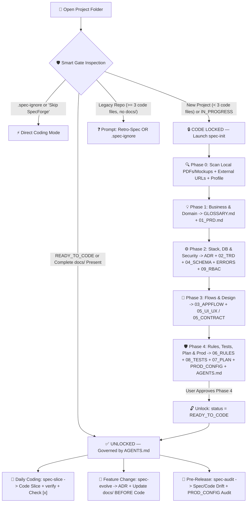

<div align="center">
  
  <h1>SpecForge — Spec-Driven AI Development</h1>
  <p><strong>Zero Hallucinations. Zero Spaghetti Code. Zero Code Before Validated Specifications.</strong></p>
  <p>
    <strong>🇬🇧 English</strong> &nbsp;|&nbsp;
    <a href="./README.fr.md">🇫🇷 Français</a> &nbsp;|&nbsp;
    <a href="./README.tr.md">🇹🇷 Türkçe</a>
  </p>
</div>

---

## 📖 Table of Contents

1. [Philosophy — Why SpecForge?](#-1-philosophy--why-specforge)
2. [How SpecForge Works (Visual Architecture)](#-2-how-specforge-works-visual-architecture)
3. [Global Installation & Uninstallation](#-3-global-installation--uninstallation)
4. [Complete A-to-Z Walkthrough: From Zero to Production](#-4-complete-a-to-z-walkthrough-from-zero-to-production)
5. [Detailed Reference of All 14 Generated Documents & Governance Pack](#-5-detailed-reference-of-all-14-generated-documents--governance-pack)
6. [Universal Platform & Stack Adaptation Matrix](#-6-universal-platform--stack-adaptation-matrix)
7. [Smart Gate Rules, Bypassing for Small Scripts, Pause/Resume & FAQ](#-7-smart-gate-rules-bypassing-for-small-scripts-pauseresume--faq)
8. [License](#-8-license)

---

## 🎯 1. Philosophy — Why SpecForge?

AI coding assistants have no built-in long-term architectural memory and no real-world business intuition. When you open an empty folder and tell an AI *"Build me a delivery/booking/SaaS app"*, predictable failures happen:
- **Hallucinated Contracts**: Frontend and backend invent incompatible routes, payloads, and error shapes.
- **Terminology Drift**: The same concept is named `Order` in one file, `Purchase` in another, and `Shipment` in the database.
- **Architectural Amnesia**: Three days later, a new chat session proposes rewriting your state manager or violates business rules established on Day 1.
- **Monolithic "God Files"**: 900-line components mixing UI, network calls, and financial math on the client side.

**SpecForge solves this permanently through *Spec-Driven AI Development*:**
> **The AI is strictly forbidden from inventing anything or writing a single line of application code until the entire project is co-designed, documented, and validated in `docs/` + `AGENTS.md`.**

Once unlocked, `docs/` acts as an immutable **Single Source of Truth**, and the AI executes cleanly slice-by-slice like a disciplined Principal Engineer.

---

## 🔄 2. How SpecForge Works (Visual Architecture)



---

## 📦 3. Global Installation & Uninstallation

SpecForge works globally across **Google Antigravity** (full native Plugin + `PreToolUse` Hook + Global Rule), **Cursor**, **Claude Code**, **Windsurf**, and **GitHub Copilot**.

### ✨ Option 1 — Zero-Terminal AI Prompt (Copy & Paste into Your AI)

Don't want to touch the terminal? **Copy-paste this exact prompt into your AI coding assistant** and let it install everything and explain the workflow to you:

```text
Install the SpecForge global plugin & skills from https://github.com/Ismael-sang98/spec-forge-skill.git on my machine:
1. Clone https://github.com/Ismael-sang98/spec-forge-skill.git into a temporary directory.
2. Detect my OS and run "./install.sh" (macOS/Linux) or "powershell -ExecutionPolicy Bypass -File .\install.ps1" (Windows) so the global plugin, Smart Gate hook, and 4 skills (spec-init, spec-slice, spec-evolve, spec-audit) are installed for my AI IDE(s).
3. Verify the installed files, remove the temporary clone folder, and then explain clearly to me how SpecForge works, how the "Zero Code Before Specs" Smart Gate protects my projects, when to use each of the 4 skills, and remind me to restart my IDE once.
```

---

### 🛠️ Option 2 — Manual Terminal Installation (Full Plugin + Smart Gate Hook)

**macOS & Linux:**
```bash
git clone https://github.com/Ismael-sang98/spec-forge-skill.git
cd spec-forge-skill
chmod +x install.sh && ./install.sh
```

**Windows (PowerShell):**
```powershell
git clone https://github.com/Ismael-sang98/spec-forge-skill.git
cd spec-forge-skill
powershell -ExecutionPolicy Bypass -File .\install.ps1
```

**Or directly via Antigravity CLI:**
```bash
agy plugin install ./spec-forge-skill
```

> **🔄 Important:** Restart your AI IDE **once** after installing so the newly created plugin directory, `PreToolUse` Smart Gate hook, global rule, and 4 skills load into active sessions.

---

### 🌐 Option 3 — Universal `npx skills` CLI (Skills-Only Mode)

```bash
npx skills add Ismael-sang98/spec-forge-skill -g
```

---

### 🗑️ Uninstallation

- **macOS / Linux**: `./install.sh --uninstall` (or `agy plugin uninstall spec-forge`)
- **Windows PowerShell**: `powershell -ExecutionPolicy Bypass -File .\install.ps1 -Uninstall`

---

## 🚀 4. Complete A-to-Z Walkthrough: From Zero to Production

Here is **every detail of what happens in practice** when you build a project with SpecForge.

### Step 0 — Prepare Your Project Folder (Optional Assets & Links)
1. Create an empty directory for your new project (e.g., `mkdir CampusBooking`) and open it in your IDE.
2. *(Optional)* If you already have supporting materials, drop them straight into the folder before starting:
   - Client requirement PDFs, university assignment briefs, raw `.md` / `.txt` notes, or `.csv` pricing sheets.
   - Figma exports, wireframes, or hand-drawn sketch photos inside `docs/maquettes/`.
   - Existing `openapi.yaml` / `swagger.json` files.

---

### Step 1 — Triggering SpecForge (Automatic Gate vs Explicit Start)

- **What happens if you forget and ask the AI to write code immediately?**  
  *(e.g., "Create a Next.js login page and Prisma schema")*  
  🛑 **The Smart Gate (`scripts/spec-gate.mjs`) physically blocks the file write (`decision: "deny"`)**! Because the folder has `< 3` code files and no validated `docs/`, the AI stops immediately and launches **`spec-init`** instead.
- **How to start intentionally (Recommended starter prompt):**
  ```text
  Use spec-init: I want to build CampusBooking, a mobile app where university students book and split payments for sports pitches. Here is an inspiration site: https://anybuddyapp.com
  ```

---

### Step 2 — How `spec-init` Understands Your Idea, Files, Links & Stack

`spec-init` is engineered as a **Principal CTO Co-Pilot** — it never dumps 40 blank questions on you at once:

1. **Multimodal Context Ingestion**:
   - Reads all PDFs, notes, and mockup screenshots (`docs/maquettes/`) dropped in your workspace using file & vision tools.
   - Searches/fetches any **external URLs** you share (competitor websites, Stripe/Iyzico/Supabase/WhatsApp API docs, GitHub repos) so third-party integrations are 100% accurate and up to date.
   - **Proactive Missing-Source Detector**: Whenever you mention complex domain math (tax brackets, customs tariffs, commissions, scoring) or external APIs, the AI proactively asks if you have a reference sheet/PDF or API doc URL before writing formulas.
2. **Adaptive Multilingual Experience**:
   - Automatically conducts the interview in **your active language** (English, Français, Türkçe, etc.).
   - Confirms in 1 click which language to write `docs/` in, while enforcing **canonical English identifiers** for all code symbols, DB columns, and API routes inside `docs/GLOSSARY.md`.
3. **2 Project Rigor Profiles**:
   - **`(Recommended)` Full Enterprise Suite (14 Docs)**: Complete specification architecture for production SaaS, client apps, mobile/desktop products, and APIs.
   - **Lean / MVP / Academic Suite (8 Core Docs)**: Streamlined bundle for smaller apps, hackathons, or university coursework (cleanly merges Glossary into PRD, Errors+RBAC into TRD, and Testing into Coding Rules).
4. **3 Stack Selection Profiles Handled Automatically**:
   - **Case A — You already know your stack** *(e.g., "Flutter + Supabase" or "React + Express + PostgreSQL")*: Validates coherence, resolves architectural blind spots (offline-first cache, auth storage, transaction boundaries), and locks it in `ADR-0001`.
   - **Case B — You are undecided**: Acts as your CTO — evaluates your constraints (team skills, `$0` free-tier budget vs cloud, deadline, platform) and compares 2–3 tailored stacks with **1 `(Recommended)` option**.
   - **Case C — Hard academic or client constraint** *(e.g., professor requires Java Spring Boot or C# .NET)*: Honors the constraint 100% and builds the cleanest architecture around it.

---

### Step 3 — The 4 Interactive Phases in Detail

At every question, `spec-init` provides a **`(Recommended)`** architect answer so you can accept in 1 click or customize. Progress is saved after every phase in `docs/.spec-state.json` (`status: "IN_PROGRESS"`), with **zero `[TODO]` placeholders** allowed in generated files:

| Phase | Questions Asked by the AI | Files Generated Immediately (100% Complete, Zero `[TODO]`) |
| :--- | :--- | :--- |
| **Phase 0**<br>*Discovery & Setup* | Raw idea, target platform (`Web`, `Mobile`, `Desktop`, `Backend/API`, `CLI`), constraints, external links/files, doc language, and Full (14) vs Lean (8) profile. | • `docs/.spec-state.json` (`status: "IN_PROGRESS"`, `currentPhase: 1`) |
| **Phase 1**<br>*Business & Domain* | Personas, MVP modules vs out-of-scope, exact pricing/currency/rounding/refund formulas, edge cases, and ambiguous business terms. | • `docs/GLOSSARY.md`<br>• `docs/01_PRD.md` |
| **Phase 2**<br>*Stack, Data & Security* | Stack & architecture pattern, entities & relations, cascades/indexes, user roles & CRUD permissions, third-party services & webhooks. | • `docs/adr/0001-stack-and-architecture.md`<br>• `docs/02_TRD_TECHNICAL_SPEC.md`<br>• `docs/04_DATABASE_SCHEMA.md`<br>• `docs/ERROR_CATALOG.md`<br>• `docs/09_RBAC_PERMISSIONS.md` |
| **Phase 3**<br>*Flows & Design / Contract* | Screen/command routing tree, Finite State Machines (allowed & forbidden status transitions), visual mockup extraction from `docs/maquettes/` (or co-designed Design Token System; or OpenAPI/CLI spec if headless). | • `docs/03_APPFLOW.md`<br>• `docs/05_UI_UX_DESIGN.md` *(or `05_INTERFACE_CONTRACT.md` for headless API/CLI)* |
| **Phase 4**<br>*Quality, Roadmap & Unlock* | Stack-specific coding rules, testing pyramid & coverage zones, ordered vertical slices, deployment target, and pre-production security checklist. | • `docs/06_CODING_RULES.md`<br>• `docs/08_TESTING_STRATEGY.md`<br>• `docs/07_IMPLEMENTATION_PLAN.md`<br>• `docs/PROD_CONFIG.md` & `docs/README.md`<br>• **Root Pack:** `AGENTS.md`, `.cursorrules`, `CLAUDE.md`, `.env.example`, `verify` command<br>• **Unlock:** `docs/.spec-state.json` $\rightarrow$ `"READY_TO_CODE"` 🔓 |

---

### Step 4 — Building, Evolving & Auditing Your Project (Daily Prompts)

Once Phase 4 is approved and unlocked (`READY_TO_CODE`), you drive the entire development lifecycle with **3 clean commands**:

#### 1. Build Feature-by-Feature (`spec-slice`)
```text
Run spec-slice to implement the next unchecked slice in docs/07_IMPLEMENTATION_PLAN.md
```
**What the AI does automatically:**
1. Reads the exact sections of `AGENTS.md`, `GLOSSARY.md`, `01_PRD`, `02_TRD`, `03_APPFLOW`, `04_DATABASE_SCHEMA`, `05_UI_UX`, and `06_CODING_RULES` for that slice.
2. Implements the vertical slice bottom-up: **Validation Schemas/DTOs $\rightarrow$ DB Model & Migration $\rightarrow$ Domain Service & ACID Transactions $\rightarrow$ Unit/Integration Tests $\rightarrow$ API/Controller $\rightarrow$ UI Components ($\le 200$ lines)**.
3. Executes your stack's **`verify`** one-liner (`typecheck + lint + test + build`) until 0 errors remain.
4. Checks off `[x]` in `docs/07_IMPLEMENTATION_PLAN.md` and outputs a mandatory **Done / Remaining / Global Progress %** report.

#### 2. Add a New Feature or Change Rules Mid-Project (`spec-evolve`)
```text
Use spec-evolve: I want to add weekend tournament brackets and Apple Pay support
```
**What the AI does automatically:**
1. Analyzes every impacted specification layer instead of hacking code blindly.
2. Asks targeted delta questions, writes a new numbered ADR (`docs/adr/0002-weekend-tournaments.md`), updates affected `docs/` files + `.env.example`, and appends a new vertical slice `[ ]` to `docs/07_IMPLEMENTATION_PLAN.md` **before** writing code.

#### 3. Audit Quality & Prepare for Production (`spec-audit`)
```text
Run spec-audit to check spec-to-code alignment and audit docs/PROD_CONFIG.md
```
**What the AI does automatically:**
1. Scans the codebase for `any`/`dynamic` leaks, oversized files (`> 200` lines), glossary naming drift, missing RBAC guards, non-transactional writes, and hardcoded secrets/demo fallbacks.
2. Runs `verify`, checks all 6 pillars of `docs/PROD_CONFIG.md`, and returns a **`0–100` Readiness Score** with `P0–P3` findings and exact fixes.

---

## 📚 5. Detailed Reference of All 14 Generated Documents & Governance Pack

```text
YourProject/
├── AGENTS.md                          # Supreme AI Constitution & 12 Stack-Tailored Commandments
├── .cursorrules                       # Automatic mirror for teammates using Cursor
├── CLAUDE.md                          # Automatic mirror for teammates using Claude Code
├── .env.example                       # Documented environment variable matrix (zero real secrets)
└── docs/
    ├── .spec-state.json               # Resumable phase tracker & READY_TO_CODE gate status
    ├── README.md                      # Central index linking all project specifications
    ├── GLOSSARY.md                    # Ubiquitous Language (Domain Term <-> English Code/DB Identifier)
    ├── ERROR_CATALOG.md               # Unified error envelope & domain error code registry
    ├── 01_PRD.md                      # Business vision, personas, invariants & worked math formulas
    ├── 02_TRD_TECHNICAL_SPEC.md       # Architecture, stack, full API/IPC contracts & ACID boundaries
    ├── 03_APPFLOW.md                  # Route/command map, sequence diagrams & Finite State Machines
    ├── 04_DATABASE_SCHEMA.md          # Mermaid ERD, formal ORM/SQL schema, cascades, indexes & seeds
    ├── 05_UI_UX_DESIGN.md             # Design tokens & screen mapping (or 05_INTERFACE_CONTRACT.md)
    ├── 06_CODING_RULES.md             # Folder architecture, <= 200-line cap & forbidden anti-patterns
    ├── 07_IMPLEMENTATION_PLAN.md      # Ordered vertical slices with [ ] / [x] checkboxes
    ├── 08_TESTING_STRATEGY.md         # Testing pyramid, reusable test factories & coverage laws
    ├── 09_RBAC_PERMISSIONS.md         # Role x Resource CRUD matrix & IDOR/multi-tenant isolation
    ├── PROD_CONFIG.md                 # 6-pillar pre-production security & deployment audit matrix
    ├── adr/                           # Immutable Architecture Decision Records
    │   └── 0001-stack-and-architecture.md
    └── maquettes/                     # Optional Figma exports / wireframes / screenshots
```

| File | Exact Role | Failure Prevented |
| :--- | :--- | :--- |
| **`AGENTS.md` / `.cursorrules` / `CLAUDE.md`** | Supreme constitution loaded by every team member's AI (even teammates without SpecForge installed!). | Prevents shortcuts, `any` types, client-side financial math, and skipped tests. |
| **`docs/GLOSSARY.md`** | Maps every local domain term (EN/FR/TR) to **one canonical English identifier** + forbidden synonyms. | Eliminates mixed naming (`Parcel` vs `Package` vs `Colis`) across DB, API, and UI. |
| **`docs/ERROR_CATALOG.md`** | Standard JSON error shape + exhaustive domain error codes, HTTP/exit statuses, and localized messages. | Eliminates vague `500 Internal Server Error` or inconsistent error handling. |
| **`docs/01_PRD.md`** | Personas, functional modules, business invariants, and exact mathematical formulas with examples. | Stops the AI from guessing tax, rounding, currency, refund, or domain logic. |
| **`docs/02_TRD_TECHNICAL_SPEC.md`** | Full stack, auth flow, every API/IPC endpoint contract, ACID transaction rules, and webhooks. | Prevents frontend/backend contract mismatches and race conditions. |
| **`docs/03_APPFLOW.md`** | Navigation tree, sequence diagrams, and Mermaid Finite State Machines (`stateDiagram-v2`). | Prevents illegal entity status transitions and broken redirect flows. |
| **`docs/04_DATABASE_SCHEMA.md`** | Mermaid `erDiagram`, complete Prisma/SQL/ORM schema, foreign keys, cascades, indexes, and prod-safe seeds. | Prevents schema drift, missing indexes, and destructive production seeding. |
| **`docs/05_UI_UX_DESIGN.md`** *(or `05_INTERFACE_CONTRACT.md`)* | Exact hex colors, typography scale, border radii, component states, and screen-by-screen layout (or OpenAPI/CLI UX). | Prevents generic, inconsistent UI styling or undocumented CLI flags. |
| **`docs/06_CODING_RULES.md`** | Idiomatic rules for the chosen language/framework, folder tree, `<= 200` line limit, and Git conventions. | Keeps the entire codebase modular, clean, and senior-grade. |
| **`docs/07_IMPLEMENTATION_PLAN.md`** | Sequential vertical slices (`Slice 0` to `Final Hardening`) with granular `[ ]` / `[x]` checkboxes. | Gives the AI unbreakable long-term memory across dozens of sessions. |
| **`docs/08_TESTING_STRATEGY.md`** | Unit/Integration/E2E tooling, reusable test data factories, and mandatory coverage zones. | Prevents fragile mocks and untested financial/business edge cases. |
| **`docs/09_RBAC_PERMISSIONS.md`** | Cross-table of every Role vs Resource/Action + field-level visibility & ownership rules. | Prevents BOLA/IDOR authorization vulnerabilities and forgotten middleware. |
| **`docs/PROD_CONFIG.md`** | 6-pillar security & deployment checklist (zero token leaks, zero demo fallbacks, rate-limiting, backups, RLS). | Blocks accidental deployment of dev mocks, leaked tokens, or weak configs. |
| **`docs/adr/NNNN-*.md`** | Timestamped Architecture Decision Records documenting *why* key choices were made. | Stops the AI from proposing conflicting libraries or rewrites weeks later. |

---

## 🌐 6. Universal Platform & Stack Adaptation Matrix

SpecForge is **100% platform- and language-agnostic**. During Phases 2–4, it adapts both specification contents and coding guardrails to your target environment:

### Platform Adaptation

| Document | 🌐 Web / SaaS | 📱 Mobile (Flutter / iOS / Android) | 🖥️ Desktop (Tauri / Electron / .NET) | ⚙️ Backend API / CLI |
| :--- | :--- | :--- | :--- | :--- |
| **`02_TRD`** | SSR/SPA, REST/GraphQL, cookies/JWT, CDN, background crons | Offline-first sync, local SQLite/Drift, push notifications, deep links | Native IPC commands, filesystem sandboxing, OS keychain, auto-update | Event queues, webhooks, rate-limiting, idempotency, streaming |
| **`03_APPFLOW`** | URL routing, auth guards, multi-step web wizards | Touch gestures, app lifecycle (`foreground/background`), safe areas | Multi-window flows, global shortcuts, system tray / menu bar | Webhook pipelines, CLI subcommand trees & exit-code flows |
| **`05_DESIGN`** | Responsive tokens, Tailwind/CSS system, desktop/mobile breakpoints | Apple HIG & Material 3 guidelines, adaptive layouts | High-density desktop layouts, keyboard-first navigation | Automatically becomes **`05_INTERFACE_CONTRACT.md`** (OpenAPI / CLI UX) |
| **`PROD_CONFIG`** | HTTPS/CORS, cookie security, CSP, cloud DB pooling & backups | APK/AAB/IPA signing, App Store / Play Store privacy & permissions | Apple Notarization / Windows Authenticode signing, DMG/MSI installers | Container hardening, secrets vault, observability, zero-downtime migrations |

### Built-In Stack Guardrails & `verify` Commands

| Stack | Enforced Guardrails in `06_CODING_RULES.md` & `AGENTS.md` | Generated `verify` Gate |
| :--- | :--- | :--- |
| **TypeScript / React / Node** | `strict: true`, zero `any`, shared Zod schemas, TanStack Query (ban `useEffect` fetching), `prisma.$transaction`, files `<= 200` lines | `npm run typecheck && npm run lint && npm run test && npm run build` |
| **Flutter / Dart** | Zero unjustified `dynamic`, Riverpod/Bloc separation, immutable `freezed`/Dart 3 sealed models, pure widgets `<= 200` lines | `dart format --output=none --set-exit-if-changed . && flutter analyze --fatal-infos --fatal-warnings && flutter test` |
| **Python (FastAPI / Django)** | `mypy --strict` / Pyright, Pydantic v2 `strict=True`, `Decimal`/`int` for money (never `float`), explicit DB transactions | `ruff check . && ruff format --check . && mypy src && pytest` |
| **Java / Kotlin (Spring Boot)** | Records/`data class` DTOs (never expose JPA `@Entity`), Jakarta `@Valid`, `@Transactional`, `BigDecimal`, Flyway/Liquibase | `./mvnw spotless:check test package` *(or `./gradlew check`)* |
| **C# / .NET** | `<Nullable>enable</Nullable>`, `<TreatWarningsAsErrors>true`, FluentValidation, Clean Architecture slices, `decimal` for money | `dotnet format --verify-no-changes && dotnet build -warnaserror && dotnet test` |
| **Go / Rust** | Go: wrapped errors, `golangci-lint`, `go test -race`. Rust: zero `.unwrap()` in prod paths, `thiserror`, `clippy -D warnings` | Go: `go vet ./... && golangci-lint run && go test -race ./...`<br>Rust: `cargo fmt --check && cargo clippy -- -D warnings && cargo test` |

---

## ❓ 7. Smart Gate Rules, Bypassing for Small Scripts, Pause/Resume & FAQ

### ⚡ Q1: What if I just want to write a tiny script, quick prototype, or homework exercise WITHOUT using SpecForge?
You have **3 effortless, zero-friction ways** to skip SpecForge anytime:
1. **Tell your AI in plain language in chat (Fastest — 0 terminal needed!)**:  
   > *"Skip SpecForge for this small project and code a quick Python script that..."*  
   The AI is authorized to automatically create an empty `.spec-ignore` file at the project root (unlocking the Smart Gate hook instantly) and start coding right away!
2. **Create `.spec-ignore` manually**: Run `touch .spec-ignore` in that folder — SpecForge ignores that folder permanently while staying active on all your real projects.
3. **Toggle the plugin off temporarily**: Disable `spec-forge` in 1 click from your IDE's Plugins panel (or run `agy plugin disable spec-forge` — takes effect live without restarting!), and turn it back on whenever you start a real project.

### ⏸️ Q2: What if I close my laptop in the middle of the 4-phase interview?
Nothing is ever lost! `spec-init` writes your progress to `docs/.spec-state.json` after every phase. Tomorrow, reopen the folder and say:
> *"Resume `spec-init`"*  
The AI reads `docs/.spec-state.json`, summarizes the phases already completed, and continues right where you stopped.

### 🏛️ Q3: What happens when I open an old existing project (`>= 3` code files) that has no `docs/`?
SpecForge **never traps you** on legacy codebases. When `spec-gate.mjs` sees `>= 3` existing source files and no `docs/`, it asks for your choice:
- **Option A — Retro-Spec Mode**: Run `spec-init` to scan your existing code, reverse-engineer `docs/` + `AGENTS.md`, and bring the legacy repo under Spec-Driven discipline.
- **Option B — Quick Hotfix / Bypass**: Approve the edit directly or drop a `.spec-ignore` file at the root.

### 👥 Q4: What if my teammates on GitHub don't have SpecForge installed on their computers?
They are **still governed by your rules**! Because `spec-init` commits `AGENTS.md`, `.cursorrules`, `CLAUDE.md`, `docs/`, and the `verify` script directly into your project repository, any teammate opening the repo in Antigravity, Cursor, Claude Code, or Copilot automatically inherits your project's 12 Commandments and specification laws.

---

## 📜 8. License

Released under the [MIT License](./LICENSE). Free to use, fork, and share with your friends, classmates, and engineering teams!
