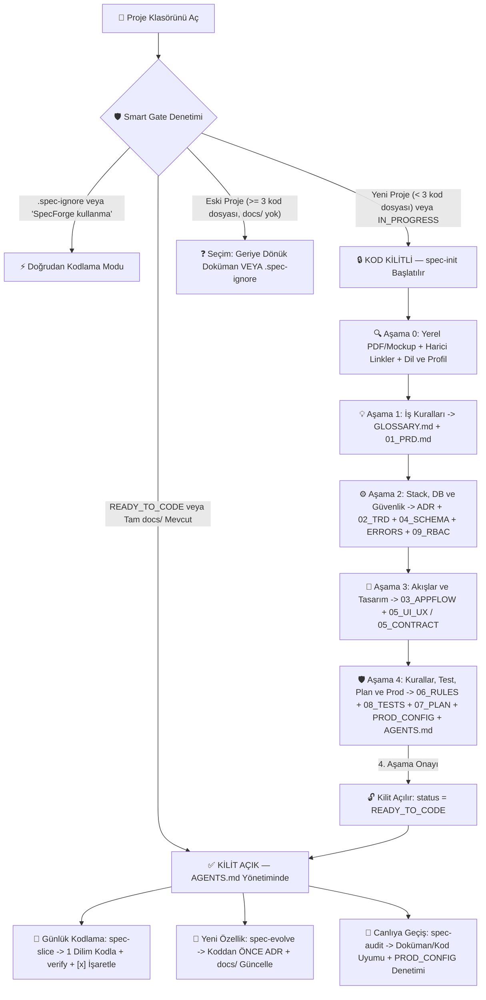

<div align="center">
  
  <h1>SpecForge — Yapay Zekâ Destekli Spesifikasyon Odaklı Geliştirme</h1>
  <p><strong>Sıfır Halüsinasyon. Sıfır Spagetti Kod. Spesifikasyonlar Onaylanmadan Tek Satır Kod Yok.</strong></p>
  <p>
    <a href="./README.md">🇬🇧 English</a> &nbsp;|&nbsp;
    <a href="./README.fr.md">🇫🇷 Français</a> &nbsp;|&nbsp;
    <strong>🇹🇷 Türkçe</strong>
  </p>
</div>

---

## 📖 İçindekiler

1. [Felsefe — Neden SpecForge?](#-1-felsefe--neden-specforge)
2. [Sistem Nasıl Çalışır? (Görsel Mimari Şeması)](#-2-sistem-nasıl-çalışır-görsel-mimari-şeması)
3. [Global Kurulum ve Kaldırma](#-3-global-kurulum-ve-kaldırma)
4. [A'dan Z'ye Adım Adım Kullanım Rehberi: Sıfırdan Canlıya (Production)](#-4-adan-zye-adım-adım-kullanım-rehberi-sıfırdan-canlıya-production)
5. [Üretilen 14 Dokümanın ve Ekip Anayasa Paketinin Detaylı Referansı](#-5-üretilen-14-dokümanın-ve-ekip-anayasa-paketinin-detaylı-referansı)
6. [Evrensel Platform ve Teknoloji Yığını (Stack) Uyum Matrisi](#-6-evrensel-platform-ve-teknoloji-yığını-stack-uyum-matrisi)
7. [Akıllı Kilit Kuralları, Küçük Projelerde Kapatma (.spec-ignore), Duraklat/Devam Et ve SSS](#-7-akıllı-kilit-kuralları-küçük-projelerde-kapatma-spec-ignore-duraklatdevam-et-ve-sss)
8. [Lisans](#-8-lisans)

---

## 🎯 1. Felsefe — Neden SpecForge?

Yapay zekâ kodlama asistanlarının doğuştan gelen uzun vadeli bir mimari hafızası veya gerçek dünya iş sezgisi yoktur. Boş bir klasör açıp yapay zekâya doğrudan *"Bana bir rezervasyon / kargo / SaaS uygulaması yaz"* dediğinizde hep aynı sorunlar yaşanır:
- **Uydurulmuş API Sözleşmeleri**: Frontend ve backend birbirine uymayan endpoint'ler, JSON yapıları ve hata mesajları üretir.
- **Kavram Karmaşası**: Aynı iş nesnesi bir dosyada `Order`, diğerinde `Purchase`, veritabanında `Shipment` adını alır.
- **Mimari Hafıza Kaybı**: Üç gün sonra açılan yeni bir oturum, 1. günde kurduğunuz mimariyi veya finansal kuralları bozan değişiklikler yapar.
- **Devasa "God Component" Dosyaları**: Arayüz, ağ istekleri ve para hesaplamalarını istemci tarafında birbirine karıştıran 900 satırlık bakımı imkânsız dosyalar oluşur.

**SpecForge bu sorunu *Spec-Driven AI Development* (Spesifikasyon Odaklı Geliştirme) disipliniyle kökten çözer:**
> **Projenin tüm iş kuralları, veritabanı, mimarisi ve ekran akışları `docs/` + `AGENTS.md` altında eksiksiz tasarlanıp onaylanmadan yapay zekânın tek bir satır bile uygulama kodu yazması teknik olarak yasaktır.**

Kilit açıldıktan sonra `docs/` klasörü **Tek Doğruluk Kaynağı (Single Source of Truth)** olur ve yapay zekâ kıdemli bir Baş Mimar (Principal Engineer) disipliniyle dilim dilim kodlama yapar.

---

## 🔄 2. Sistem Nasıl Çalışır? (Görsel Mimari Şeması)



---

## 📦 3. Global Kurulum ve Kaldırma

SpecForge bilgisayarınıza global olarak kurulur ve **Google Antigravity** (Tam Eklenti + `PreToolUse` Hook + Global Kural), **Cursor**, **Claude Code**, **Windsurf** ve **GitHub Copilot** ile çalışır.

### ✨ Seçenek 1 — Tek Tıkla Yapay Zekâ Promptu ile Otomatik Kurulum (Terminalsiz!)

Terminal komutlarıyla hiç uğraşmak istemiyorsanız **aşağıdaki metni kopyalayıp doğrudan yapay zekâ asistanınıza yapıştırın**; kurulumu otomatik yapsın ve sistemi size anlatsın:

```text
https://github.com/Ismael-sang98/spec-forge-skill.git adresindeki SpecForge eklentisini ve yeteneklerini (skills) bilgisayarıma global olarak kur:
1. https://github.com/Ismael-sang98/spec-forge-skill.git deposunu geçici bir klasöre klonla.
2. İşletim sistemimi algıla ve macOS/Linux ise "./install.sh", Windows ise "powershell -ExecutionPolicy Bypass -File .\install.ps1" komutunu çalıştırarak tam eklentiyi, Smart Gate kilidini ve 4 skill'i (spec-init, spec-slice, spec-evolve, spec-audit) global olarak yükle.
3. Dosyaların başarıyla kurulduğunu doğrula, geçici klon klasörünü temizle ve ardından bana Türkçe olarak SpecForge'un nasıl çalıştığını, "Spesifikasyon Olmadan Kod Yok" kilidinin projelerimi nasıl koruduğunu, 4 skill'in ne zaman kullanıldığını açıkla ve IDE'mi bir kez yeniden başlatmamı hatırlat.
```

---

### 🛠️ Seçenek 2 — Terminal ile Manuel Kurulum (Tam Eklenti + Akıllı Kilit Hook)

**macOS ve Linux:**
```bash
git clone https://github.com/Ismael-sang98/spec-forge-skill.git
cd spec-forge-skill
chmod +x install.sh && ./install.sh
```

**Windows (PowerShell):**
```powershell
git clone https://github.com/Ismael-sang98/spec-forge-skill.git
cd spec-forge-skill
powershell -ExecutionPolicy Bypass -File .\install.ps1
```

**Veya doğrudan Antigravity CLI ile:**
```bash
agy plugin install ./spec-forge-skill
```

> **🔄 Önemli:** Kurulumdan sonra yeni eklenti dizininin, `PreToolUse` Smart Gate kilidinin, global kuralın ve 4 skill'in aktifleşmesi için IDE'nizi **bir kez** yeniden başlatın.

---

### 🌐 Seçenek 3 — Evrensel `npx skills` CLI (Yalnızca Skill Modu)

```bash
npx skills add Ismael-sang98/spec-forge-skill -g
```

---

### 🗑️ Kurulumu Kaldırma (Uninstall)

- **macOS / Linux**: `./install.sh --uninstall` (veya `agy plugin uninstall spec-forge`)
- **Windows PowerShell**: `powershell -ExecutionPolicy Bypass -File .\install.ps1 -Uninstall`

---

## 🚀 4. A'dan Z'ye Adım Adım Kullanım Rehberi: Sıfırdan Canlıya (Production)

SpecForge kurulduktan sonra sıfırdan bir projeyi nasıl başlatıp bitireceğinizin **tüm prosedür detayları** aşağıdadır:

### Adım 0 — Proje Klasörünü Hazırlama (İsteğe Bağlı Ek Dosyalar ve Linkler)
1. Yeni projeniz için boş bir klasör oluşturun (ör. `mkdir KampusSaha`) ve IDE'nizde açın.
2. *(İsteğe Bağlı)* Elinizde hazır materyaller varsa başlamadan önce doğrudan bu klasöre bırakabilirsiniz:
   - Müşteri şartnamesi (`.pdf`), üniversite proje ödevi föyü, `.md` / `.txt` notlar veya `.csv` fiyat tabloları.
   - `docs/maquettes/` klasörü içine Figma ekran görüntüleri, wireframe'ler veya kağıt üzerindeki çizim fotoğrafları.
   - Mevcut `openapi.yaml` veya `swagger.json` dosyaları.

---

### Adım 1 — SpecForge'u Başlatma (Otomatik Kilit vs Doğrudan Başlatma)

- **Kuralı unutup doğrudan kod yazmasını isterseniz ne olur?**  
  *(ör. "Bana Flutter ile giriş ekranı ve veritabanı kodla")*  
  🛑 **Akıllı Kilit (`scripts/spec-gate.mjs`) kod dosyası oluşturulmasını fiziksel olarak engeller (`decision: "deny"`)**! Klasörde 3'ten az kod dosyası olduğu ve onaylı `docs/` bulunmadığı için yapay zekâ anında durur ve otomatik olarak **`spec-init`** sürecini başlatır.
- **Doğrudan başlatmak için önerilen ilk mesaj:**
  ```text
  spec-init kullan: Üniversite öğrencilerinin halı saha kiralayıp ücreti kendi aralarında bölüşebileceği KampusSaha adlı bir mobil uygulama yapmak istiyorum. Beğendiğim örnek sistem: https://anybuddyapp.com
  ```

---

### Adım 2 — `spec-init` Fikrinizi, Ek Belgeleri, Linkleri ve Stack Seçimini Nasıl Anlar?

`spec-init` sizi boş sorularla yormayan bir **CTO Yardımcı Pilotu** gibi çalışır:

1. **Çok Modlu Bağlam Okuma (Multimodal Ingestion)**:
   - Klasöre attığınız tüm PDF'leri, notları ve `docs/maquettes/` içindeki tasarım görsellerini dosya ve görüntü okuma araçlarıyla inceler.
   - Paylaştığınız **harici URL linklerini** (rakip siteler, Iyzico/Stripe/Supabase/WhatsApp resmi API dokümanları, GitHub depoları) web araçlarıyla tarar; eski veya hayali API uç noktaları uydurmaz.
   - **Proaktif Eksik Belge Dedektörü**: Vergi, gümrük, komisyon, puanlama gibi karmaşık hesaplamalardan veya harici bir servisten bahsettiğiniz anda formül uydurmak yerine *"Bununla ilgili bir fiyat tablonuz/PDF'iniz veya API doküman linkiniz var mı?"* diye sorar.
2. **Çok Dilli Akıllı Deneyim**:
   - Mülakatı otomatik olarak **sizin konuştuğunuz dilde** (Türkçe, Fransızca, İngilizce vb.) yürütür.
   - Tek tıkla `docs/` dosyalarının dilini onaylatır; ancak kod kalitesi için tüm değişken, sınıf, tablo ve API isimlerini `docs/GLOSSARY.md` üzerinden **temiz İngilizce** olarak sabitler.
3. **2 Farklı Proje Yoğunluk Profili**:
   - **`(Recommended)` Tam Kurumsal Paket (14 Doküman)**: Gerçek SaaS ürünleri, müşteri projeleri, kapsamlı mobil/masaüstü uygulamalar için eksiksiz mimari.
   - **Lean / MVP / Akademik Paket (8 Temel Doküman)**: Üniversite ders projeleri, hackathonlar veya küçük araçlar için hızlandırılmış paket (Sözlük+PRD, Hatalar+RBAC ve Test+Kod Kurallarını akıllıca birleştirir).
4. **3 Farklı Teknoloji Seçimi Senaryosu**:
   - **Durum A — Kullanacağınız stack'i zaten biliyorsanız** *(ör. "Flutter + Supabase" veya "Spring Boot + React + PostgreSQL")*: Tutarlılığı doğrular, gözden kaçan mimari noktaları (offline çalışma, oturum güvenliği, transaction sınırları) netleştirir ve `ADR-0001` dosyasına işler.
   - **Durum B — Kararsızsanız veya en iyi mimariyi bilmiyorsanız**: Kıdemli bir CTO gibi kısıtlarınızı (ekip bilgisi, `0 TL` ücretsiz bütçe vs bulut, teslim tarihi, işletim sistemi) analiz eder ve **1 tanesi `(Recommended)`** olmak üzere 2–3 alternatif stack karşılaştırması sunar.
   - **Durum C — Zorunlu ders veya müşteri kısıtı varsa** *(ör. hoca zorunlu Java veya C# .NET istediyse)*: Kısıta %100 uyar ve o teknoloji için en temiz mimariyi kurar.

---

### Adım 3 — 4 Etkileşimli Aşamanın Tüm Detayları

Her soruda yapay zekâ ilk sıraya **`(Recommended)`** (Önerilen) cevabını koyar; tek tıkla onaylayabilir veya değiştirebilirsiniz. İlerleme her aşama sonunda `docs/.spec-state.json` dosyasına kaydedilir ve üretilen hiçbir dosyada **`[TODO]` / boş şablon bırakılmaz**:

| Aşama | Yapay Zekânın Sorduğu Sorular | Anında Üretilen Dosyalar (%100 Dolu, Sıfır `[TODO]`) |
| :--- | :--- | :--- |
| **Aşama 0**<br>*Keşif ve Kurulum* | Ham fikir, hedef platform (`Web`, `Mobile`, `Desktop`, `Backend/API`, `CLI`), kısıtlar, ek dosya/linkler, doküman dili ve Tam (14) vs Lean (8) profili. | • `docs/.spec-state.json` (`status: "IN_PROGRESS"`, `currentPhase: 1`) |
| **Aşama 1**<br>*İş Kuralları ve Alan* | Kullanıcı profilleri, MVP kapsamı ve kapsam dışı bırakılanlar, net fiyat/para birimi/yuvarlama/iade formülleri, sınır durumları ve terimler. | • `docs/GLOSSARY.md`<br>• `docs/01_PRD.md` |
| **Aşama 2**<br>*Stack, Veri ve Güvenlik* | Stack ve mimari desen, tablolar ve ilişkiler, indeksler/silme kuralları, kullanıcı rolleri ve CRUD yetkileri, üçüncü parti servisler. | • `docs/adr/0001-stack-and-architecture.md`<br>• `docs/02_TRD_TECHNICAL_SPEC.md`<br>• `docs/04_DATABASE_SCHEMA.md`<br>• `docs/ERROR_CATALOG.md`<br>• `docs/09_RBAC_PERMISSIONS.md` |
| **Aşama 3**<br>*Akışlar ve Tasarım / API* | Ekran/komut haritası, Sonlu Durum Makineleri (izin verilen ve yasaklı durum geçişleri), `docs/maquettes/` tasarım analizi (veya sıfırdan Tasarım Sistemi; arayüzsüz projelerde OpenAPI/CLI sözleşmesi). | • `docs/03_APPFLOW.md`<br>• `docs/05_UI_UX_DESIGN.md` *(arayüzsüz API/CLI ise `05_INTERFACE_CONTRACT.md`)* |
| **Aşama 4**<br>*Kalite, Plan ve Kilit Açma* | Seçilen stack'e özel kodlama kuralları, test piramidi, dikey dilim (slice) sıralaması, sunucu hedefi ve canlıya geçiş güvenlik listesi. | • `docs/06_CODING_RULES.md`<br>• `docs/08_TESTING_STRATEGY.md`<br>• `docs/07_IMPLEMENTATION_PLAN.md`<br>• `docs/PROD_CONFIG.md` & `docs/README.md`<br>• **Kök Paket:** `AGENTS.md`, `.cursorrules`, `CLAUDE.md`, `.env.example`, `verify` komutu<br>• **Kilit Açma:** `docs/.spec-state.json` $\rightarrow$ `"READY_TO_CODE"` 🔓 |

---

### Adım 4 — Kilit Açıldıktan Sonra Kodlama, Geliştirme ve Denetim (Günlük Komutlar)

4. Aşama onaylanıp `READY_TO_CODE` olduktan sonra tüm projeyi **3 net komutla** yönetirsiniz:

#### 1. Adım Adım Özellik Kodlama (`spec-slice`)
```text
docs/07_IMPLEMENTATION_PLAN.md içindeki sıradaki tamamlanmamış dilimi kodlamak için spec-slice çalıştır
```
**Yapay zekâ otomatik olarak ne yapar?**
1. İlgili dilim için `AGENTS.md`, `GLOSSARY.md`, `01_PRD`, `02_TRD`, `03_APPFLOW`, `04_DATABASE_SCHEMA`, `05_UI_UX` ve `06_CODING_RULES` bölümlerini okur.
2. Dilimi aşağıdan yukarıya eksiksiz kodlar: **Doğrulama/DTO $\rightarrow$ Veritabanı Modeli ve Migration $\rightarrow$ Servis Katmanı ve ACID Transaction $\rightarrow$ Birim/Entegrasyon Testleri $\rightarrow$ Controller/API $\rightarrow$ UI Bileşenleri ($\le 200$ satır)**.
3. Projenin **`verify`** komutunu (`typecheck + lint + test + build`) 0 hata kalana kadar çalıştırır.
4. `docs/07_IMPLEMENTATION_PLAN.md` içinde tamamlanan kutuları `[x]` yapar ve **Yapılanlar / Kalanlar / Genel İlerleme %** raporunu sunar.

#### 2. Proje Ortasında Yeni Özellik veya Kural Değişikliği (`spec-evolve`)
```text
spec-evolve kullan: Hafta sonu turnuva sistemi ve Apple Pay ödemesi eklemek istiyorum
```
**Yapay zekâ otomatik olarak ne yapar?**
1. Doğrudan koda dalıp mimariyi bozmak yerine etkilenen tüm dokümanları tespit eder.
2. Netleştirici sorular sorar, yeni bir ADR kararı (`docs/adr/0002-haftasonu-turnuva.md`) yazar, `docs/` dosyalarını + `.env.example` şablonunu günceller ve kod yazmadan **önce** plana yeni bir `[ ]` dilimi ekler.

#### 3. Kalite Kontrolü ve Canlıya Çıkış Denetimi (`spec-audit`)
```text
Kodun docs/ ile uyumunu ve docs/PROD_CONFIG.md güvenlik listesini denetlemek için spec-audit çalıştır
```
**Yapay zekâ otomatik olarak ne yapar?**
1. Tüm kodu `any`/`dynamic` kaçakları, `> 200` satırı aşan dosyalar, sözlük uyumsuzlukları, unutulmuş RBAC yetki kontrolleri, transaction dışı yazma işlemleri ve unutulmuş demo şifreleri/token sızıntıları için tarar.
2. `verify` komutunu koşar, `docs/PROD_CONFIG.md` içindeki 6 güvenlik sütununu tek tek kontrol eder ve `P0–P3` bulgularıyla birlikte **`100` üzerinden Hazırlık Puanı** üretir.

---

## 📚 5. Üretilen 14 Dokümanın ve Ekip Anayasa Paketinin Detaylı Referansı

```text
Projeniz/
├── AGENTS.md                          # Proje Anayasası ve Stack'e Özel 12 Altın Kural
├── .cursorrules                       # Cursor kullanan ekip arkadaşları için otomatik kural aynası
├── CLAUDE.md                          # Claude Code kullanan ekip arkadaşları için kural aynası
├── .env.example                       # Açıklamalı ortam değişkenleri matrisi (gerçek şifre içermez)
└── docs/
    ├── .spec-state.json               # Aşama takipçisi ve READY_TO_CODE kilit durumu
    ├── README.md                      # Tüm spesifikasyonları birbirine bağlayan merkezi indeks
    ├── GLOSSARY.md                    # Ortak Alan Dili (Türkçe Terim <-> İngilizce Kod/DB Adı)
    ├── ERROR_CATALOG.md               # Standart JSON hata zarfı ve hata kodları kataloğu
    ├── 01_PRD.md                      # İş vizyonu, personalar, değişmez kurallar ve örnekli formüller
    ├── 02_TRD_TECHNICAL_SPEC.md       # Mimari, stack, tam API/IPC sözleşmeleri ve ACID sınırları
    ├── 03_APPFLOW.md                  # Ekran/komut haritası, akış şemaları ve Durum Makineleri (FSM)
    ├── 04_DATABASE_SCHEMA.md          # Mermaid ERD, tam ORM/SQL şeması, indeksler ve güvenli seed'ler
    ├── 05_UI_UX_DESIGN.md             # Tasarım token'ları ve ekran eşleşmeleri (veya 05_INTERFACE_CONTRACT.md)
    ├── 06_CODING_RULES.md             # Klasör mimarisi, <= 200 satır sınırı ve yasaklı anti-pattern'ler
    ├── 07_IMPLEMENTATION_PLAN.md      # [ ] / [x] onay kutulu sıralı dikey dilim uygulama planı
    ├── 08_TESTING_STRATEGY.md         # Test piramidi, yeniden kullanılabilir test fabrikaları ve kapsama
    ├── 09_RBAC_PERMISSIONS.md         # Rol x Kaynak CRUD yetki matrisi ve çoklu kiracı izolasyonu
    ├── PROD_CONFIG.md                 # 6 sütunlu canlıya geçiş ve güvenlik sıkılaştırma kontrol listesi
    ├── adr/                           # Değiştirilemez Mimari Karar Kayıtları (ADR)
    │   └── 0001-stack-and-architecture.md
    └── maquettes/                     # İsteğe bağlı Figma çıktıları / wireframe / ekran görüntüleri
```

| Dosya | Tam Rolü | Önlediği Hata |
| :--- | :--- | :--- |
| **`AGENTS.md` / `.cursorrules` / `CLAUDE.md`** | Ekipteki herkesin yapay zekâsı tarafından otomatik okunan proje anayasası (SpecForge kurulu olmasa bile!). | Kestirme çözümleri, `any` kullanımını, istemcide para hesabını ve testsiz kodu engeller. |
| **`docs/GLOSSARY.md`** | Her yerel iş terimini (TR/FR/EN) **tek bir İngilizce kod kimliğine** bağlar, yasaklı eş anlamlıları listeler. | Veritabanı, API ve arayüz arasındaki isimlendirme karmaşasını sıfırlar. |
| **`docs/ERROR_CATALOG.md`** | Tek tip hata JSON yapısı + tüm hata kodları, HTTP durumları ve kullanıcı mesajları. | Belirsiz `500 Internal Server Error` hatalarını ve tutarsız bildirimleri bitirir. |
| **`docs/01_PRD.md`** | Personalar, fonksiyonel modüller, iş değişmezleri ve sayısal örnekli matematiksel formüller. | Yapay zekânın KDV, komisyon, yuvarlama veya iade kurallarını kafasından uydurmasını önler. |
| **`docs/02_TRD_TECHNICAL_SPEC.md`** | Tam teknoloji yığını, kimlik doğrulama, tüm API uç noktaları, ACID transaction sınırları ve webhook'lar. | Frontend ile backend arasındaki veri uyuşmazlıklarını ve yarış durumlarını (race condition) önler. |
| **`docs/03_APPFLOW.md`** | Rota ağacı, sıralama diyagramları ve Mermaid Sonlu Durum Makineleri (`stateDiagram-v2`). | Yasaklı durum geçişlerini (ör. teslim edilmiş siparişin iptal edilmesi) engeller. |
| **`docs/04_DATABASE_SCHEMA.md`** | Mermaid `erDiagram`, tam Prisma/SQL/ORM şeması, yabancı anahtarlar, indeksler ve prod korumalı seed. | Şema kaymalarını, indekssiz yavaş sorguları ve canlı verinin yanlışlıkla sıfırlanmasını önler. |
| **`docs/05_UI_UX_DESIGN.md`** *(veya `05_INTERFACE_CONTRACT.md`)* | Tam hex renk kodları, tipografi, köşe yuvarlaklıkları, bileşen durumları ve ekran yerleşimleri (veya OpenAPI/CLI). | Yapay zekânın sıradan, uyumsuz ve tasarımdan kopuk arayüzler üretmesini engeller. |
| **`docs/06_CODING_RULES.md`** | Seçilen dile özgü kurallar, klasör ağacı, `<= 200` satır sınırı ve Git commit standartları. | Kod tabanının baştan sona modüler, okunabilir ve Senior seviyesinde kalmasını sağlar. |
| **`docs/07_IMPLEMENTATION_PLAN.md`** | `Dilim 0`'dan `Canlıya Geçiş`'e kadar `[ ]` / `[x]` kutucuklu sıralı dikey geliştirme planı. | Yapay zekâya onlarca farklı oturum boyunca asla kaybolmayan kalıcı bir hafıza kazandırır. |
| **`docs/08_TESTING_STRATEGY.md`** | Birim/Entegrasyon/E2E araçları, test veri fabrikaları (*Test Factories*) ve zorunlu kapsama alanları. | Kırılgan mock'ları ve test edilmemiş kritik hesaplama hatalarını ortadan kaldırır. |
| **`docs/09_RBAC_PERMISSIONS.md`** | Rol x Kaynak/İşlem yetki tablosu + hassas alan görünürlüğü ve veri sahipliği kuralları. | BOLA/IDOR yetki açıklarını ve unutulan yetki ara katmanlarını (middleware) engeller. |
| **`docs/PROD_CONFIG.md`** | 6 sütunlu güvenlik listesi (sıfır token sızıntısı, sıfır demo verisi, rate-limiting, yedekleme, RLS). | Test şifrelerinin veya güvenlik açıklarının yanlışlıkla canlıya çıkmasını durdurur. |
| **`docs/adr/NNNN-*.md`** | Önemli teknik kararların *neden* alındığını belgeleyen tarihli Mimari Karar Kayıtları. | Yapay zekânın haftalar sonra kütüphane değiştirme veya mimariyi bozma tekliflerini keser. |

---

## 🌐 6. Evrensel Platform ve Teknoloji Yığını (Stack) Uyum Matrisi

SpecForge **her türlü yazılım projesinde** çalışır. 2–4. aşamalarda doküman içeriklerini ve kod kurallarını hedef platformunuza göre şekillendirir:

### Platforma Göre Uyarlama

| Doküman | 🌐 Web / SaaS | 📱 Mobil (Flutter / iOS / Android) | 🖥️ Masaüstü (Tauri / Electron / .NET) | ⚙️ Backend API / CLI |
| :--- | :--- | :--- | :--- | :--- |
| **`02_TRD`** | SSR/SPA, REST/GraphQL, çerez/JWT güvenliği, CDN, cron görevleri | Offline-first senkronizasyon, yerel SQLite/Drift, Push bildirimler, Deep Link | Yerel IPC komutları, dosya sistemi güvenliği, OS anahtarlığı, otomatik güncelleme | Kuyruk yapıları (Queue), webhook, rate-limiting, idempotency |
| **`03_APPFLOW`** | URL rotaları, yetki korumaları, çok adımlı formlar | Dokunmatik hareketler, yaşam döngüsü (`foreground/background`), Safe Area | Çoklu pencere yönetimi, global kısayollar, sistem tepsisi (Tray) | Asenkron iş akışları, CLI alt komut ağacı ve çıkış kodları (exit codes) |
| **`05_DESIGN`** | Responsive token'lar, Tailwind/CSS, mobil/masaüstü kırılımları | Apple HIG ve Material Design 3 kuralları, uyarlanabilir yerleşim | Yüksek yoğunluklu masaüstü ekranlar, klavye odaklı kullanım | Otomatik olarak **`05_INTERFACE_CONTRACT.md`** (OpenAPI / CLI UX) olur |
| **`PROD_CONFIG`** | HTTPS/CORS, güvenli çerezler, CSP, DB bağlantı havuzu ve yedekler | APK/AAB/IPA imzalama, App Store / Play Store gizlilik ve izinleri | Apple Notarization / Windows kod imzalama, DMG/MSI kurulum paketleri | Konteyner güvenliği, şifre kasası (Vault), izleme, kesintisiz migration |

### Teknoloji Yığınına (Stack) Özel Kurallar ve `verify` Komutları

| Teknoloji Yığını | `06_CODING_RULES.md` ve `AGENTS.md` İçinde Zorunlu Kılınan Kurallar | Üretilen `verify` Doğrulama Komutu |
| :--- | :--- | :--- |
| **TypeScript / React / Node** | `strict: true`, sıfır `any`, paylaşımlı Zod şemaları, TanStack Query (`useEffect` ile fetch yasak), `prisma.$transaction`, `<= 200` satır | `npm run typecheck && npm run lint && npm run test && npm run build` |
| **Flutter / Dart** | Gereksiz `dynamic` yasağı, UI / Riverpod veya Bloc / Repository ayrımı, `freezed`/Dart 3 sealed modeller, saf widget'lar `<= 200` satır | `dart format --output=none --set-exit-if-changed . && flutter analyze --fatal-infos --fatal-warnings && flutter test` |
| **Python (FastAPI / Django)** | `mypy --strict` / Pyright, Pydantic v2 `strict=True`, para için `Decimal`/`int` (`float` yasak), açık DB transaction blokları | `ruff check . && ruff format --check . && mypy src && pytest` |
| **Java / Kotlin (Spring Boot)** | Record/`data class` DTO (JPA `@Entity` dışarı açılmaz), `@Valid`, `@Transactional`, `BigDecimal`, Flyway/Liquibase | `./mvnw spotless:check test package` *(veya `./gradlew check`)* |
| **C# / .NET** | `<Nullable>enable</Nullable>`, `<TreatWarningsAsErrors>true`, FluentValidation, Clean Architecture katmanları, para için `decimal` | `dotnet format --verify-no-changes && dotnet build -warnaserror && dotnet test` |
| **Go / Rust** | Go: sarmalanmış hatalar, `golangci-lint`, `go test -race`. Rust: canlı kodda `.unwrap()` yasağı, `thiserror`, `clippy -D warnings` | Go: `go vet ./... && golangci-lint run && go test -race ./...`<br>Rust: `cargo fmt --check && cargo clippy -- -D warnings && cargo test` |

---

## ❓ 7. Akıllı Kilit Kuralları, Küçük Projelerde Kapatma (`.spec-ignore`), Duraklat/Devam Et ve SSS

### ⚡ S1: Çok küçük bir script, hızlı bir deneme veya küçük bir ders ödevi yaparken SpecForge ile uğraşmak istemezsem ne yapacağım?
SpecForge'u istediğiniz an devre dışı bırakmanın **zahmetsiz 3 yolu** vardır:
1. **Doğrudan sohbetten yapay zekâya söyleyin (En Hızlısı — Terminal Gerekmez!)**:  
   > *"Bu küçük projede SpecForge kullanma, doğrudan şu işi yapan bir Python scripti yaz..."*  
   Yapay zekâ kök dizine otomatik olarak boş bir `.spec-ignore` dosyası oluşturma yetkisine sahiptir; böylece Smart Gate kilidi anında açılır ve tek soru sormadan kodlamaya başlar!
2. **Kendiniz `.spec-ignore` dosyası oluşturun**: Klasörde `touch .spec-ignore` çalıştırın (veya sağ tıkla `.spec-ignore` adında boş dosya açın). SpecForge diğer tüm gerçek projelerinizi korumaya devam ederken yalnızca o klasörü tamamen yok sayar.
3. **Eklentiyi tek tıkla geçici olarak kapatın**: IDE'nizin Eklentiler (Plugins) panelinden `spec-forge` anahtarını kapatın (veya `agy plugin disable spec-forge` çalıştırın — yeniden başlatmadan anında uygulanır!), gerçek bir projeye geçtiğinizde tekrar açın.

### ⏸️ S2: 4 aşamalı mülakatın ortasında (örneğin 2. aşamada) bilgisayarımı kapatmam gerekirse ne olur?
Hiçbir şey kaybolmaz! `spec-init` her aşama sonunda ilerlemenizi `docs/.spec-state.json` dosyasına kaydeder. Ertesi gün klasörü açıp şunu yazmanız yeterlidir:
> *"`spec-init` işlemine kaldığımız yerden devam et"*  
Yapay zekâ `docs/.spec-state.json` dosyasını okur, tamamlanan aşamaları özetler ve doğrudan kaldığınız aşamadan devam eder.

### 🏛️ S3: İçinde zaten kod bulunan eski bir projeyi (`>= 3` kod dosyası var ama `docs/` yok) açarsam ne olur?
SpecForge mevcut projelerinizi **asla zorla kilitlemez**. Klasörde 3 veya daha fazla kod dosyası gördüğünde size seçimi bırakır:
- **Seçenek A — Geriye Dönük Dokümantasyon (Retro-Spec)**: `spec-init` çalıştırarak mevcut kodunuzu taratabilir, `docs/` + `AGENTS.md` dokümanlarını otomatik çıkarttırıp projeyi koruma altına alabilirsiniz.
- **Seçenek B — Hızlı Düzeltme / Bypass**: Doğrudan düzenlemeye onay verebilir veya kök dizine `.spec-ignore` bırakabilirsiniz.

### 👥 S4: GitHub'daki grup arkadaşlarımın bilgisayarında SpecForge kurulu değilse ne olur?
Onların yapay zekâları da **sizin kurallarınıza uymak zorunda kalır**! Çünkü `spec-init` projenin kök dizinine `AGENTS.md`, `.cursorrules`, `CLAUDE.md`, `docs/` ve `verify` doğrulama komutunu ekleyip Git'e dahil eder. Projeyi klonlayan her ekip arkadaşı (Antigravity, Cursor, Claude Code veya Copilot fark etmeksizin) projenin 12 Altın Kuralını otomatik olarak devralır.

---

## 📜 8. Lisans

[MIT Lisansı](./LICENSE) altında açık kaynak olarak sunulmuştur — arkadaşlarınızla, sınıf arkadaşlarınızla ve yazılım ekiplerinizle özgürce paylaşabilirsiniz!
